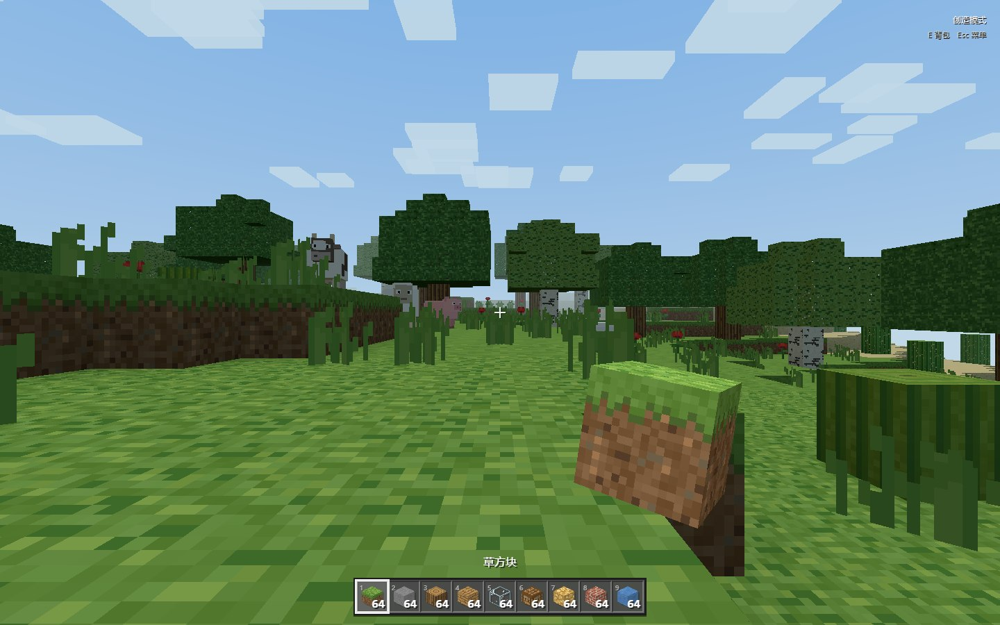

# MC · 我的方块世界

一个中文、完全 3D、可保存的浏览器体素沙盒。使用 Three.js 渲染，拥有程序化世界、第一人称移动、生存与创造模式、挖掘建造、合成烧炼、昼夜天气与生物。

**这是独立实现的可玩项目，不是 Minecraft 官方客户端，也不是与某个原版版本零偏差的复刻。** 不包含 Mojang/Microsoft 的游戏代码、材质包、商标图形或音频文件。纹理、模型、天空与音效由项目代码生成。完整功能与明确差异见 [功能说明](docs/FEATURES.md)。



## 启动

需要 Node.js 22.12+，以及支持 WebGL 2 的现代桌面浏览器。

```sh
npm ci
npm run dev
```

打开终端显示的本地地址，选择「单人游戏 → 创建新的世界」。生产构建：

```sh
npm run build
npm run preview
```

将 `dist/` 的全部内容放到任何静态网站服务器即可运行。构建使用相对资源路径，支持 GitHub Pages 仓库子路径。不能通过双击 `index.html` 的 `file://` 方式运行模块项目。所有游戏资源随构建打包，游玩过程中不依赖外部 CDN。

## 已有玩法

- **世界**：固定种子可复现，区块加载与卸载，平原、森林、沙漠、雪地、山地和海岸，树木、草花、洞穴与煤铁金钻石矿石。
- **生存**：碰撞、跳跃、潜行防掉落、疾跑、游泳、氧气、摔落、饥饿、回血、死亡掉落和重生。
- **创造**：无限放置、快速挖掘、双击空格飞行、分类搜索物品、鼠标中键取方块。
- **物品**：36 格背包、9 格快捷栏、堆叠拆分、快速转移、工具等级与耐久、地面掉落和拾取。
- **制作**：2×2 随身合成、3×3 工作台、配方书、镜像配方、熔炉烧炼、箱子储物。
- **环境**：20 分钟昼夜、太阳与月亮、星空、移动方块云、雨、距离雾与水下效果。
- **生物**：猪、羊、牛、夜间僵尸，移动与肢体动画、攻击和掉落、阳光燃烧、墙体遮挡。
- **交互**：挖掘裂纹与碎片、手持工具动画、材质脚步声、可点燃和连锁引爆的 TNT。
- **存档**：多个世界、自动保存、导入导出；保存方块修改、背包、容器、昼夜、生物、地面物品和临时合成物品。

## 操作

| 操作 | 按键 |
| --- | --- |
| 移动 / 视角 | WASD / 鼠标 |
| 跳跃、上浮 | 空格 |
| 潜行、飞行下降 | Shift |
| 疾跑 | Ctrl |
| 挖掘 / 攻击 | 按住鼠标左键 |
| 放置 / 使用 / 打开工作台、熔炉、箱子 | 鼠标右键 |
| 背包 / 关闭背包 | E |
| 快捷栏 | 1–9 / 鼠标滚轮 |
| 创造飞行开关 | 快速双击空格 |
| 创造取方块 | 鼠标中键 |
| 丢出一个 / 一组 | Q / Ctrl+Q |
| 食用手持食物 | F 或右键 |
| 坐标与性能 | F3 |
| 生存 / 创造切换 | F4 或暂停菜单 |
| 命令 | T 或 /，输入 `/help` |
| 暂停、释放鼠标 | Esc |

触屏设备提供移动、视角、跳跃、挖掘和放置按钮，主要游玩与验证平台为桌面浏览器。背包左键移动整组，右键拆半/放一个，Shift+点击快速转移。

内嵌预览窗口如果不支持鼠标锁定，会自动进入兼容操作模式：**Alt＋左键拖动视角**，其余移动、挖掘和放置按键照常使用。“回到游戏”可以正常恢复，不需要授予额外浏览器权限。

## 存档与设置

存档位于当前浏览器、当前网站地址的 `localStorage`，每 20 秒及退出时保存。清除网站数据、更换浏览器或网站地址不会自动迁移存档；请在暂停菜单导出 JSON，再在世界选择界面导入。保存空间不足会显示提示，可立即导出备份。

支持调整渲染距离、视野、灵敏度、音量与视角摇晃。较慢的设备可使用 2–3 区块渲染距离。首次生成周围地形需要数秒。

## 验证

```sh
npm test
npm run build
```

自动测试覆盖地形确定性、区块接缝、DDA 选块、网格法线、编辑持久化、碰撞与摔落、存档校验、背包物品守恒、合成、熔炉和生物行为。

浏览器端端到端验证：

```sh
npx playwright install chromium
npm run test:e2e
```

测试会启动本地开发服务器，在独立浏览器上下文中创建测试世界，并验证真实鼠标挖掘/放置、合成、读档、创造物品搜索、飞行、设置、天气和死亡重生。可设置 `MC_BROWSER_PATH` 使用本机 Chrome/Edge；测试截图保存在忽略的 `.qa/` 中。

## 代码结构

| 文件 | 职责 |
| --- | --- |
| `src/terrain.js`、`src/world.js` | 种子生成、区块、网格、选块 |
| `src/textures.js`、`src/data.js` | 程序纹理、图标、物品定义 |
| `src/player.js` | 角色移动与生存物理 |
| `src/inventory.js`、`src/recipes.js` | 背包、容器、合成与烧炼 |
| `src/ui.js`、`src/style.css` | 中文菜单与游戏 HUD |
| `src/environment.js`、`src/entities.js` | 天空、天气、生物 |
| `src/audio.js`、`src/visuals.js` | 合成音效、手持和粒子 |
| `src/storage.js`、`src/main.js` | 存档和系统集成 |

尚未实现下界/末地、多人网络协议、红石电路、村庄交易、附魔药水、完整农业与所有原版实体/物品。水体为静态方块；世界高度、照明、战斗数值、部分配方和界面均与原版存在差异，详见 [功能范围](docs/FEATURES.md)。
